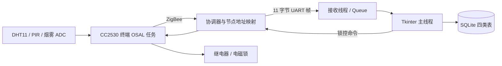

# 智能实验室设备管理 / Smart Lab

将 CC2530 终端、ZigBee 协调器和 Python/Tkinter 管理端连接起来，演示环境感知、设备借还、锁控和告警。

**性质**：无线传感网课程设计。

## 功能与实现

- UART 为 115200 bps、11 字节帧，包含帧头/帧尾和低 8 位累加校验和；协调器配置 10 项终端登记容量。
- OSAL 定时配置：PIR 200 ms、烟雾 1 s、温湿度 3 s；烟雾使用 ADC 原始值 1200/1000 双阈值和越阈计数。
- 上位机后台线程接收数据，50 ms 主线程轮询消费 Queue；活动告警按节点去重。
- SQLite 建立设备、借还、柜体状态、告警 4 类表，支持锁控下发、借还登记和使用时长统计。

## 目录与入口



- `firmware/coordinator/SmartCabinetCoordinator.c`
- `firmware/coordinator/SmartCabinetCoordinator.h`
- `firmware/end-device/SmartCabinetEndDevice.c`
- `firmware/end-device/SmartCabinetEndDevice.h`
- `host/smart_lab.py`
- `requirements.txt`

## 环境与运行

先按角色将 `firmware/coordinator/`、`firmware/end-device/` 的应用文件集成到原始 TI Z-Stack CC2530 工程中，使用 IAR for 8051 构建。

上位机从本项目目录启动：

```bash
python -m pip install -r requirements.txt
cd host
python smart_lab.py
```

连接界面选择真实协调器串口及 115200 波特率。

## 验证范围与复现说明

- 使用工程实际引用的 CC2530DB 终端版本，未发布根目录中返回固定温湿度示例值的旧稿。
- 当前数据库初始化会尝试删除旧数据库，不能宣称跨重启保留历史；不要直接用于真实实验室账务。
- 借还登记目前不等待设备执行确认，未实现端到端事务一致性；10 项是地址登记容量，不是已验收的 10 节点并发。
- 越阈计数在中间滞回区间保留，因此是“3 次越阈”，不表述为严格连续 3 次。

## 资料与来源

保留源码中的课程、厂商与开源来源标注。依赖与权重按各自许可另行获取。

[返回项目总览](../../README.md)
