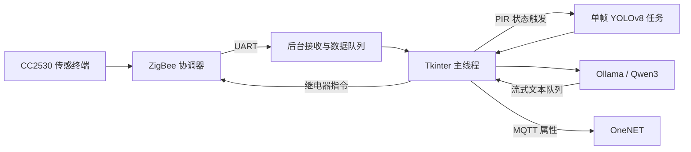

# 智守夕阳 / SmartGuardian

以 Python 边缘网关连接 CC2530/ZigBee 传感节点、单帧视觉分析、本地 Qwen3 与 OneNET，演示异常状态提示和本地继电器干预。

**性质**：课程综合设计 · 网关与边缘 AI 原型。

## 功能与实现

- 5 类 Queue 与 100 ms UI 轮询解耦串口、视觉、模型生成及日志展示；解析 12 字节混合编码帧。
- PIR 活动到静止的状态变化触发单帧 YOLOv8 人体检测；视觉任务同一时刻最多 1 个。
- 使用 person 框宽高比规则提示疑似跌倒，未将通用 YOLO 模型表述为已训练的专用跌倒分类器。
- 通过病历文本上下文和 Ollama 流式调用生成提示；覆盖最多 8 项 OneNET 物模型属性，常规上报间隔配置为 10 s。
- 燃气读数使用 180/120 双阈值处理继电器动作；这些是代码阈值，不是已校准的物理浓度。

## 目录与入口



- `firmware/application/DHT11.c`
- `firmware/application/DHT11.h`
- `firmware/application/GenericApp.h`
- `firmware/application/coordinator.c`
- `firmware/application/ds18b20.c`
- `firmware/application/ds18b20.h`
- `firmware/application/enddevice.c`
- `gateway_core.py`
- `gateway_gui.py`
- `llm_core.py`
- `patient_record.example.txt`
- `requirements.txt`
- `vision_core.py`

## 环境与运行

使用独立 Python 3 环境；先检查串口、摄像头或 GPIO 等外设配置。

```bash
python -m pip install -r requirements.txt
python gateway_gui.py
```

配置 `gateway_gui.py` 中的串口及 OneNET 产品/设备信息；发布副本已移除鉴权值。先在本机准备 Ollama 的 `qwen3` 模型及 `yolov8n.pt`，将 `patient_record.example.txt` 复制为 `patient_record.txt` 并按实际授权范围填写。摄像头只在触发后采帧。

## 验证范围与复现说明

- 软件数据流：`CC2530 → ZigBee 协调器 → UART → Queue/Tkinter → YOLO/Ollama → MQTT/OneNET`。
- 病历为提示词上下文注入，没有向量索引或检索阶段，不宣称完整 RAG。
- 未附识别准确率、算法处理 FPS 或端到端延迟的独立评测；100 ms、10 s 是调度配置。
- MQTT 当前使用 QoS 0；视觉标注图仍在本地 UI 展示，不宣称图像立刻销毁。
- 固件仅含课程应用层覆盖文件，需要原始 TI Z-Stack/板卡驱动。生成的文本用于原型展示，不作为专业诊疗结论。

## 资料与来源

保留源码中的课程、厂商与开源来源标注。依赖与权重按各自许可另行获取。

[返回项目总览](../../README.md)
