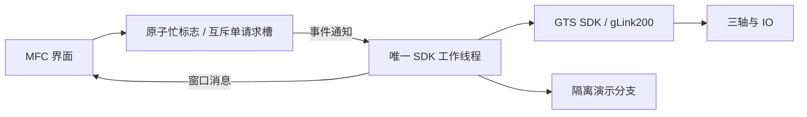

# 固高三轴运动控制台 / Tri-axis Motion Console

面向 GTS-800-PG 与 gLink200 课程设备的 Win32 MFC 上位机，覆盖轴控、IO、示教、轨迹和自动抓放。

**性质**：C++/MFC 综合实训。

## 功能与实现

- 单工作线程串行调用控制卡 SDK，原子忙标志拒绝重入，事件唤醒任务并通过窗口消息向 UI 回传状态。
- 空闲轮询配置为 200 ms；提供三轴 HOME、按住式 JOG、点位示教和参数保存。
- 支持直线、圆弧、正三角形、圆形 4 类轨迹，将抓取/放置/复位编排为 9 步自动流程。
- 包含光幕/停止输入软件联锁、DI0/DI1 端位等待、可取消轮询、超时中止和隔离演示模式。

## 目录与入口



单请求槽不是可无限排队的任务队列；已有任务执行时拒绝重复请求，以保持硬件调用顺序。

- `GtMotionController.cpp`
- `GtMotionController.h`
- `JogHoldButton.cpp`
- `JogHoldButton.h`
- `MotionMessages.h`
- `TrapDemoMFC.cpp`
- `TrapDemoMFC.h`
- `TrapDemoMFC.rc`
- `TrapDemoMFC.slnx`
- `TrapDemoMFC.vcxproj`
- `TrapDemoMFCDlg.cpp`
- `TrapDemoMFCDlg.h`
- `build-pdb-check.props`
- `framework.h`
- `pch.cpp`
- `pch.h`
- `res/TrapDemoMFC.ico`
- `res/TrapDemoMFC.rc2`
- 其余文件见当前目录（共 20 个源码/设计文件）。

## 环境与运行

使用 Visual Studio 安装“使用 C++ 的桌面开发”、MFC、Windows 10 SDK 和 **v142 / Win32** 工具集。自行取得与设备/固件匹配的 `gts.h`、`gts.lib`、`gts.dll`、`GTS800.cfg`、`ExtMdl.cfg`，放到工程要求的位置。

```powershell
msbuild TrapDemoMFC.vcxproj /p:Configuration=Release /p:Platform=Win32
```

无控制卡时在初始化前选择“隔离演示模式”。真实设备运行前按本机 IO 接线、极性、限位、HOME 和气路重新确认。

## 验证范围与复现说明

- 发布包不包含专有 GTS SDK、驱动和课程设备配置，缺少这些输入时工程不会完整链接。
- 设备按无编码器反馈的开环步进配置，规划位置不代表机械到位或无丢步。
- 10 ms 为部分运动等待循环的 Sleep 配置，不等于已实测的急停响应上限；软件联锁不代替硬件安全回路。
- 演示模式与真实 IO 隔离，不能将演示结果作为实机抓放成功率或机械精度。

## 资料与来源

保留源码中的课程、厂商与开源来源标注。依赖与权重按各自许可另行获取。

[返回项目总览](../../README.md)
