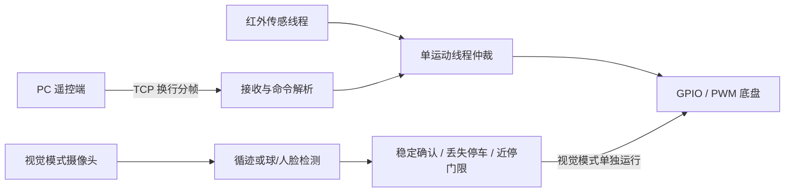

# 树莓派视觉感知与控制小车 / Vision Smart Car

由 Day1 到 Day4 逐步整合差速底盘、TCP 遥控、红外避障、视觉循迹和球/人脸目标跟随。

**性质**：综合实训 · GPIO、通信与视觉控制。

## 功能与实现

- `common/` 封装 GPIO/PWM、云台、换行分帧文本协议与动作仲裁。
- Day2 综合服务使用运动、红外采样和状态回传 3 个后台线程；状态回传周期配置为 1.5 s。
- Day3 以 ROI 分割、近远参考点、位置平滑和差速 PWM 实现视觉循迹，丢线先停车。
- Day4 使用 HSV/霍夫圆/轮廓候选及 Haar 人脸检测，包含目标关联、连续 3 帧确认、近停与 90% 恢复门限。
- 课程报告记录约 73.8 s 实车循迹演示；按时长校准的矩形轨迹，单次终点偏差记录为 2 cm。

## 目录与入口

Day2 遥控服务与 Day3/Day4 视觉驱动是独立运行入口，不能同时争用同一底盘。



- `Day1/00_hello_motor.py`
- `Day1/01_motor_selftest.py`
- `Day1/02_speed_gears.py`
- `Day1/03_button_start.py`
- `Day1/04_L2_8zi_trajectory.py`
- `Day1/05_L3_rect_closedloop.py`
- `Day1/06_L3_servo_init.py`
- `Day1/common/__init__.py`
- `Day1/common/car_config.py`
- `Day1/common/control_server.py`
- `Day1/common/gimbal.py`
- `Day1/common/motor.py`
- `Day1/common/protocol.py`
- `Day1/基础运动试用/basic_motion_oop.py`
- `Day1/基础运动试用/basic_motion_procedural.py`
- `Day2/06_infrared_avoid.py`
- `Day2/07_remote_car_server.py`
- `Day2/07_remote_pc_client.py`
- 其余文件见当前目录（共 56 个源码/设计文件）。

## 环境与运行

在树莓派中按 `requirements.txt` 准备完整硬件环境。Windows/Linux 开发机仅做视觉预览时，可使用独立的视觉依赖清单，避免安装树莓派 GPIO 包。先仅预览，确认外设与轮向后再进入实车模式。

```bash
python -m pip install -r requirements-vision.txt
python Day4/smart_tracker.py --source 0 --mode ball
python Day3/05_line_follow.py --source 0
```

Day2 综合服务：`python Day2/08_L3_threaded_server.py`；PC 端入口为 `Day2/07_remote_pc_client.py`。人脸模式需自行提供 OpenCV 4.x 的正面人脸 Haar 级联，保存为 `Day4/face.xml`，或通过 `--cascade` 指定路径。实车 Day4 需显式传入 `--drive`；视频文件始终作为离线预览。

安装 OpenCV 后，可从其自带数据目录准备级联文件（在本项目根目录执行）：

```bash
python -c "import cv2, shutil; from pathlib import Path; shutil.copy(Path(cv2.data.haarcascades) / 'haarcascade_frontalface_default.xml', Path('Day4/face.xml'))"
```

如果选择 Picamera2 后端，需要树莓派系统提供的 `python3-picamera2`/libcamera 环境；GPIO 与 PCA9685 云台驱动只在目标板卡环境安装和验证。

## 验证范围与复现说明

- 该协议为 UTF-8 换行分帧文本，不是 JSON。当前服务按单个 PC 连接设计，不宣称多客户端并发。
- 2 cm 对应矩形轨迹的单次课程测试，不是视觉循迹平均误差或编码器重复定位精度；约 74 s 是演示录像时长，不是处理帧率。
- 预览默认不发送电机指令；在不具备 RPi.GPIO 的开发机上，可按视觉入口所需依赖单独安装 OpenCV/NumPy，避免安装硬件包。
- 未上传照片、录像、Haar 级联及模型权重；`common/` 在部分 Day 目录内的副本保留原有导入方式。

## 资料与来源

保留源码中的课程、厂商与开源来源标注。依赖与权重按各自许可另行获取。

[返回项目总览](../../README.md)
